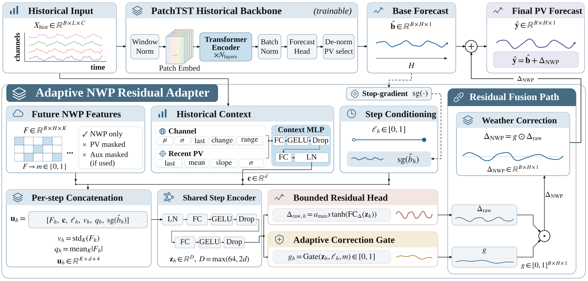

# WSPR: History-Anchored NWP Residual Correction for PV Forecasting

[中文](README.md) | English

Implementation and experimental results for:

**Direct and residual NWP integration for photovoltaic power forecasting: Metric, subset and temporal dependence**  
Xingyu Meng, Liejun Wang and Feng Yan  
Xinjiang University

## Overview

Numerical weather prediction (NWP) provides future weather information for photovoltaic (PV) power forecasting. This study asks how to use that information: predict the target directly, or correct a forecast derived from historical observations?

WSPR implements the second pathway. It retains a historical forecast as an additive base and learns an NWP-driven correction conditioned on historical context. A bounded residual head and an adaptive amplitude gate control the correction. The study compares three separately trained pathways under shared data splits, seeds and training settings:

| Pathway | Forecast construction | PatchTST implementation | iTransformer implementation |
| --- | --- | --- | --- |
| History-only | Forecast from historical inputs | `PatchTST` | `iTransformer` |
| Direct-NWP | Predict the target from history and future NWP | `DirectNWP` | `DirectNWP_iTransformer` |
| Residual-NWP | Add an NWP-driven correction to a historical forecast | `WSPR` | `WSPR_iTransformer` |

The comparison separates the benefit of adding NWP from the choice of integration pathway, and examines how that choice depends on the error metric, generation subset and evaluation period.

## Model architecture



The residual adapter uses historical context and future NWP to produce a bounded correction and an amplitude gate. Stop-gradient applies to the copy of the base forecast used for adapter conditioning; the additive base path remains trainable. The NWP availability mask indicates covariate presence.

## Installation

```bash
git clone https://github.com/MVTC-Lab/WSPR.git
cd WSPR
conda create -n wspr python=3.8.20 -y
conda activate wspr
```

The research environment used Python 3.8.20, PyTorch 2.4.0, NumPy 1.23.5 and pandas 1.5.3. Install the appropriate PyTorch 2.4.0 build for your hardware using the [official installation instructions](https://pytorch.org/get-started/previous-versions/#v240), then install the remaining dependencies:

```bash
python -m pip install -r requirements.txt
python run.py --help
```

Run all commands below from the repository root. CUDA was used for the research experiments; separate CPU interface checks are documented in [the environment test report](docs/TEST_REPORT_20261002.md).

## Data preparation

| Dataset | Study setting | Forecast duration |
| --- | --- | --- |
| PVOD | Ten PV sites; 15-minute resolution | 4 h and 24 h |
| GEFCom2014 Solar | Three regions; hourly resolution | 24 h and 96 h |
| PVDAQ with HRRR | Three additional PV sites; hourly resolution | 4 h and 24 h |

Datasets, trained checkpoints and prediction arrays are not included. For PVOD, the primary comparison uses the first 80% of each prepared station series, followed by a chronological 70/10/20 split within that retained series. GEFCom inputs use the corrected within-cycle deaccumulation.

Prepare and verify PVOD files, replacing the raw-data path with your local directory:

```bash
python scripts/prepare_pvod.py --raw-dir /path/to/PVOD_archives --out-dir outputs/pvod_prepared
python scripts/verify_data.py --dataset PVOD --data-dir outputs/pvod_prepared/PVOD_pre80
```

Prepare and verify corrected GEFCom files:

```bash
python scripts/prepare_gefcom.py --raw-zip /path/to/GEFCom2014.zip --out-dir outputs/gefcom_prepared
python scripts/verify_data.py --dataset GEFCom --data-dir outputs/gefcom_prepared/GEFCom2014Solar_deaccum_v1
```

Each preparation command requires a new output directory. For the training examples, copy the verified dataset directories into `data/`:

```text
data/
  PVOD_pre80/
    PVOD_station00_nwp.csv
    ...
    PVOD_station09_nwp.csv
  GEFCom2014Solar_deaccum_v1/
    GEFCom2014Solar_zone01_nwp.csv
    GEFCom2014Solar_zone02_nwp.csv
    GEFCom2014Solar_zone03_nwp.csv
```

PVDAQ--HRRR uses a separate origin-indexed loader and fixed UTC splits. See the [independent-validation guide](docs/INDEPENDENT_VALIDATION.md) for its configuration, required cache files and execution instructions.

## Training and evaluation

Use the command generator to select a dataset, backbone, pathway, forecast horizon and seed. For a PatchTST-based WSPR forecast at a 4-hour horizon on PVOD:

```bash
python scripts/print_commands.py --dataset PVOD --backbone patchtst --pathway residual --horizon 16 --seed 2024
```

The final printed line is a complete `python run.py ...` command. Copy and execute that line to train the model and evaluate its selected checkpoint. The generator itself only prints the command. Its examples use the first site or region; change `--data_path` to select another unit.

| Option | Values |
| --- | --- |
| `--dataset` | `PVOD`, `GEFCom` |
| `--backbone` | `patchtst`, `itransformer` |
| `--pathway` | `history`, `direct`, `residual` |
| `--horizon` | PVOD: `16`, `96`; GEFCom: `24`, `96` (time steps) |
| `--seed` | `2024`, `2025`, `2026` |

The generated command includes the training settings in [primary_matrix.json](configs/primary_matrix.json) and the required `--allow_training` flag. Use a distinct `--model_id` for each experiment. Checkpoints and evaluation artifacts are written under `outputs/`.

For evaluation with an existing compatible checkpoint, use its matching configuration with `--is_training 0` and the correct `--checkpoints` directory. For CPU execution, use `--gpu_type cpu` and omit `--use_amp`. The archived run identifiers and scalar records are provided for comparison with new runs; the generated examples do not contain every original run command.

## Results and verification

The following task means match the current manuscript. MSE and MAE are on each unit's training-standardized scale; lower is better. Seeds are averaged within units before equal-unit aggregation.

| Backbone | Dataset and horizon | History-only MSE / MAE | Direct-NWP MSE / MAE | Residual-NWP MSE / MAE |
| --- | --- | --- | --- | --- |
| PatchTST | PVOD 4 h | 0.1497 / 0.1963 | 0.1546 / 0.1811 | 0.1356 / 0.1961 |
| PatchTST | PVOD 24 h | 0.3196 / 0.3020 | 0.2125 / 0.2147 | 0.2077 / 0.2411 |
| PatchTST | GEFCom 24 h | 0.1820 / 0.2395 | 0.0932 / 0.1612 | 0.0906 / 0.1644 |
| PatchTST | GEFCom 96 h | 0.2043 / 0.2545 | 0.0858 / 0.1539 | 0.0887 / 0.1620 |
| iTransformer | PVOD 4 h | 0.1798 / 0.2250 | 0.1573 / 0.1837 | 0.1461 / 0.1974 |
| iTransformer | PVOD 24 h | 0.3319 / 0.3161 | 0.2195 / 0.2191 | 0.2031 / 0.2348 |
| iTransformer | GEFCom 24 h | 0.1860 / 0.2539 | 0.0932 / 0.1595 | 0.0939 / 0.1705 |
| iTransformer | GEFCom 96 h | 0.2176 / 0.2748 | 0.0886 / 0.1528 | 0.0907 / 0.1612 |


The primary comparison contains 468 evaluations across PVOD and corrected GEFCom. A separate PVDAQ--HRRR validation contains 108 fits. Errors are averaged over seeds within each physical unit before task-level aggregation.

PVOD comparisons show that the preferred pathway can change with the metric, generation subset and evaluation period. On PVDAQ--HRRR, both NWP pathways improve over History-only, and Direct-NWP achieves lower task-mean MSE and MAE than Residual-NWP in all four backbone-horizon tasks. These results support choosing the integration pathway for the intended evaluation setting.

Inspect and reaggregate the recorded results without downloading datasets or installing the training dependencies:

```bash
python scripts/verify_release.py
python scripts/summarize_primary.py
python scripts/summarize_independent.py
python scripts/summarize_legacy_posthoc.py
```

These commands check package integrity and recompute summaries from the included scalar records. Synthetic model and loader checks are available after installing the training dependencies:

```bash
python scripts/smoke_test.py --output outputs/smoke_report.json
python scripts/independent_validation/test_contracts.py --output outputs/independent_smoke_report.json
```

The repository includes the model implementations, preparation scripts, selected experiment configurations and aggregate results. Source datasets, trained checkpoints and prediction arrays are obtained or generated separately. Full HRRR download/cache construction and all ablation and figure-generation pipelines are not packaged. See [reproduction coverage](docs/PAPER_CODE_MAP.md) and [reproduction details](docs/REPRODUCIBILITY.md) for the inputs and steps available for each study.

## Repository structure

```text
assets/          Model overview
configs/         Task settings, run registry and independent-validation protocol
data_provider/   Forecasting data loaders
docs/            Data preparation, reproduction coverage and test reports
exp/             Training and evaluation routines
layers/          Neural-network building blocks
models/          History-only, Direct-NWP and Residual-NWP implementations
results/         Aggregate experimental records
scripts/         Data preparation, command generation and verification
utils/           Metrics, losses and training utilities
run.py           Primary training and evaluation entry point
```

## Companion numerical records

[Electronic_Supplement.zip](Electronic_Supplement.zip) contains analysis results, split records, protocols and integrity manifests accompanying the paper and supplementary PDF. It is distributed separately through this repository. Complete original datasets, trained weights and prediction arrays are not included. Extract the archive and run `verify_package.py` to check its integrity. Paths beginning with `electronic_supplement/` in the paper refer to the extracted archive root.

## Citation

The work is currently a manuscript. Its bibliographic information is:

```bibtex
@misc{meng2026wspr,
  title  = {Direct and residual NWP integration for photovoltaic power forecasting: Metric, subset and temporal dependence},
  author = {Meng, Xingyu and Wang, Liejun and Yan, Feng},
  year   = {2026},
  note   = {Manuscript},
  url    = {https://github.com/MVTC-Lab/WSPR}
}
```

## Acknowledgments and license

This implementation builds on [Time-Series-Library](https://github.com/thuml/Time-Series-Library), [PatchTST](https://github.com/yuqinie98/PatchTST) and [iTransformer](https://github.com/thuml/iTransformer). We thank the PVOD, GEFCom2014 Solar, PVDAQ and HRRR data providers.

WSPR-specific contributions are released under the [MIT license](LICENSE). Third-party components retain their original licenses, as listed in [THIRD_PARTY_NOTICES.md](THIRD_PARTY_NOTICES.md).

## Contact

For questions about the paper or code, contact Feng Yan at [yf@xju.edu.cn](mailto:yf@xju.edu.cn).
