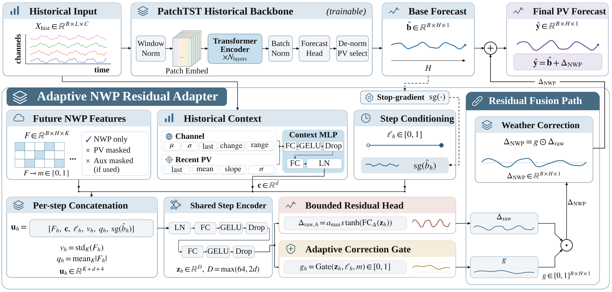

# WSPR：基于历史预测锚点的自适应天气残差校正

中文 | [English](README-EN.md)

本仓库提供论文 **Direct and residual NWP integration for photovoltaic power forecasting: Metric, subset and temporal dependence** 的模型实现、数据准备工具、实验配置与聚合结果。作者：Xingyu Meng、Feng Yan，Xinjiang University。

## 项目简介

数值天气预报（NWP）能够为光伏功率预测提供未来天气信息。本研究比较三种路径：只使用历史序列、直接融合天气预测目标、围绕历史预测进行天气残差校正。WSPR保留可训练的历史预测作为加性基准，通过有界残差头和自适应幅度门控学习天气校正。

| 历史骨干 | History-only | Direct-NWP | Residual-NWP |
| --- | --- | --- | --- |
| PatchTST | `models/PatchTST.py` | `models/DirectNWP.py` | `models/WSPR.py` |
| iTransformer | `models/iTransformer.py` | `models/DirectNWP_iTransformer.py` | `models/WSPR_iTransformer.py` |

各路径分别训练，在每个任务内使用一致的数据划分、随机种子和训练设置。本研究比较完整实现，路径之间的头部、边界与梯度路由有差异。

## 模型结构



最终输出为历史预测加上门控残差。Stop-gradient只作用于适配器使用的历史预测副本，最终加法中的历史基准仍然可训练。门控控制校正幅度，不表示已经校准的天气不确定性。

## 环境安装

实验环境为Python 3.8.20、PyTorch 2.4.0、NumPy 1.23.5和pandas 1.5.3。先安装适合本机的PyTorch 2.4.0版本，再安装其余依赖：

```bash
git clone https://github.com/MVTC-Lab/WSPR.git
cd WSPR
conda create -n wspr python=3.8.20 -y
conda activate wspr
python -m pip install -r requirements.txt
python run.py --help
```

PyTorch的CPU/CUDA安装方式见[官方历史版本说明](https://pytorch.org/get-started/previous-versions/#v240)。上述仓库地址用于发布后克隆，所有命令均从仓库根目录执行。

## 数据集与准备

**仓库不包含数据集、训练权重或预测数组。** 数据需要从原始提供方获取，并按[数据准备说明](docs/DATA.md)在本地处理。

| 数据集 | 任务 | 原始数据入口 |
| --- | --- | --- |
| PVOD | 10个站点，15分钟分辨率，4 h和24 h预测 | [Science Data Bank](https://doi.org/10.11922/sciencedb.01094) |
| GEFCom2014 Solar | 3个区域，小时分辨率，24 h和96 h预测 | [IEEE PES](https://ieee-pes-data-sharing.org/datasets/detail/b1680aa5-a4b8-4423-8760-e509094cacec) |
| PVDAQ与HRRR | 3个外部站点，4 h和24 h预测 | [PVDAQ](https://doi.org/10.25984/1846021)、[HRRR](https://rapidrefresh.noaa.gov/hrrr/) |

PVOD主比较先保留完整处理序列的前80%，再在其中按70/10/20作时间划分。GEFCom使用周期内去累积后的修正输入；PVDAQ–HRRR使用单独的起点索引加载器。

```bash
python scripts/prepare_pvod.py --raw-dir /path/to/PVOD_archives --out-dir outputs/pvod_prepared
python scripts/verify_data.py --dataset PVOD --data-dir outputs/pvod_prepared/PVOD_pre80

python scripts/prepare_gefcom.py --raw-zip /path/to/GEFCom2014.zip --out-dir outputs/gefcom_prepared
python scripts/verify_data.py --dataset GEFCom --data-dir outputs/gefcom_prepared/GEFCom2014Solar_deaccum_v1
```

准备脚本要求新的输出目录。将核验后的数据放到本地忽略目录`data/PVOD_pre80/`或`data/GEFCom2014Solar_deaccum_v1/`。CSV中`date`在首列、`OT`在最后一列，变量顺序及通道数见[输入约定](docs/DATA.md)。外部验证见[专门说明](docs/INDEPENDENT_VALIDATION.md)。

## 训练与测试

先生成与论文设置一致的示例命令，例如PVOD、PatchTST骨干、Residual路径、4小时预测：

```bash
python scripts/print_commands.py --dataset PVOD --backbone patchtst --pathway residual --horizon 16 --seed 2024
```

生成器只打印命令。复制最后一行的`python run.py ...`并执行后才会开始训练。示例默认使用第一个站点/区域，可通过`--data_path`更换；全部路径须使用与任务匹配的配置。

| 参数 | 可选值 |
| --- | --- |
| `--dataset` | `PVOD`、`GEFCom` |
| `--backbone` | `patchtst`、`itransformer` |
| `--pathway` | `history`、`direct`、`residual` |
| `--horizon` | PVOD：16/96步；GEFCom：24/96步 |
| `--seed` | 2024、2025、2026 |

训练配置见[primary_matrix.json](configs/primary_matrix.json)。训练需要显式传入`--allow_training`；每次使用独立的`--model_id`，输出保存在`outputs/`。已有兼容权重的测试使用`--is_training 0`及相同模型配置、准确的checkpoint路径。CPU执行使用`--gpu_type cpu`并移除`--use_amp`。

## 主要结果

主比较包括468条记录：PVOD 360条、修正GEFCom 108条。下面给出与当前主文一致的任务均值，每个站点/区域内先平均三个种子，再对物理单元等权平均；MSE/MAE位于各单元训练标准化尺度，越低越好。

| Backbone | Dataset and horizon | History-only MSE / MAE | Direct-NWP MSE / MAE | Residual-NWP MSE / MAE |
| --- | --- | --- | --- | --- |
| PatchTST | PVOD 4 h | 0.1497 / 0.1963 | 0.1546 / 0.1811 | 0.1356 / 0.1961 |
| PatchTST | PVOD 24 h | 0.3196 / 0.3020 | 0.2125 / 0.2147 | 0.2077 / 0.2411 |
| PatchTST | GEFCom 24 h | 0.1820 / 0.2395 | 0.0932 / 0.1612 | 0.0906 / 0.1644 |
| PatchTST | GEFCom 96 h | 0.2043 / 0.2545 | 0.0858 / 0.1539 | 0.0887 / 0.1620 |
| iTransformer | PVOD 4 h | 0.1798 / 0.2250 | 0.1573 / 0.1837 | 0.1461 / 0.1974 |
| iTransformer | PVOD 24 h | 0.3319 / 0.3161 | 0.2195 / 0.2191 | 0.2031 / 0.2348 |
| iTransformer | GEFCom 24 h | 0.1860 / 0.2539 | 0.0932 / 0.1595 | 0.0939 / 0.1705 |
| iTransformer | GEFCom 96 h | 0.2176 / 0.2748 | 0.0886 / 0.1528 | 0.0907 / 0.1612 |

PVOD主比较的MSE偏向Residual路径，全样本MAE偏向Direct路径，生成子集与后续时段会改变部分排序。单独的PVDAQ–HRRR验证包含108次拟合，Direct在全部4个骨干–预测长度任务中均取得更低的任务均值MSE和MAE。结果支持按评价目标和数据条件选择路径。

## 结果核对与复现范围

以下命令只核对文件或重新汇总既有标量结果，不下载数据、不训练模型：

```bash
python scripts/verify_release.py
python scripts/summarize_primary.py
python scripts/summarize_independent.py
python scripts/summarize_legacy_posthoc.py
```

安装依赖后，可用合成输入检查模型接口和数据约定：

```bash
python scripts/smoke_test.py --output outputs/smoke_report.json
python scripts/independent_validation/test_contracts.py --output outputs/independent_smoke_report.json
```

仓库提供六个模型、必要依赖、准备脚本、选定配置和完整范围内的聚合结果。全部历史训练命令、HRRR下载/QC/cache流水线及所有消融/绘图生成器并未统一打包；详细范围见[代码覆盖表](docs/PAPER_CODE_MAP.md)和[复现说明](docs/REPRODUCIBILITY.md)。

## 目录结构

```text
WSPR/
├── assets/          模型图
├── configs/         任务配置与运行记录
├── data_provider/   数据加载代码
├── docs/            数据格式、复现与测试说明
├── exp/             训练与评估逻辑
├── layers/          网络组件
├── licenses/        上游许可文本
├── models/          六个路径与骨干实现
├── results/         聚合结果，不含样本数据
├── scripts/         数据准备、命令生成及核验
├── utils/           指标与训练工具
├── README-EN.md     英文说明
├── requirements.txt
└── run.py
```

## 引用

当前为论文稿件，未填写期刊录用信息或DOI：

```bibtex
@misc{meng2026wspr,
  title  = {Direct and residual NWP integration for photovoltaic power forecasting: Metric, subset and temporal dependence},
  author = {Meng, Xingyu and Yan, Feng},
  year   = {2026},
  note   = {Manuscript},
  url    = {https://github.com/MVTC-Lab/WSPR}
}
```

## 致谢与许可

本项目基于[Time-Series-Library](https://github.com/thuml/Time-Series-Library)、[PatchTST](https://github.com/yuqinie98/PatchTST)及[iTransformer](https://github.com/thuml/iTransformer)。感谢PVOD、GEFCom、PVDAQ及HRRR数据提供方。

保留现有的[WSPR自有贡献MIT许可](LICENSE)及[第三方许可说明](THIRD_PARTY_NOTICES.md)，第三方文件继续适用各自许可。联系方式：Feng Yan，yf@xju.edu.cn。
